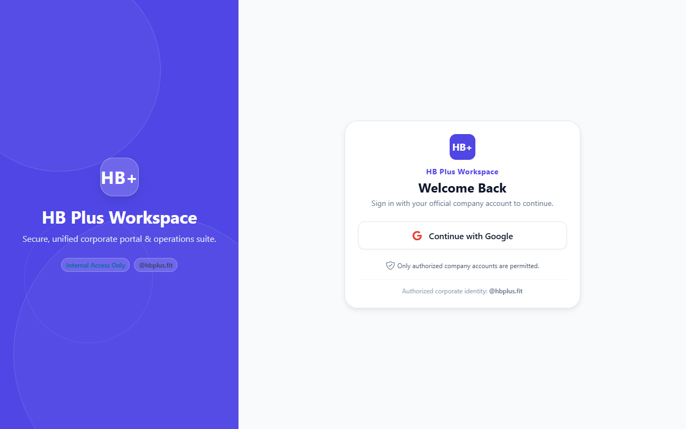
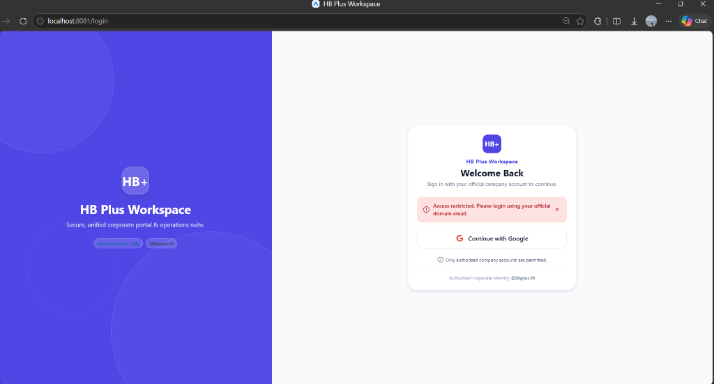
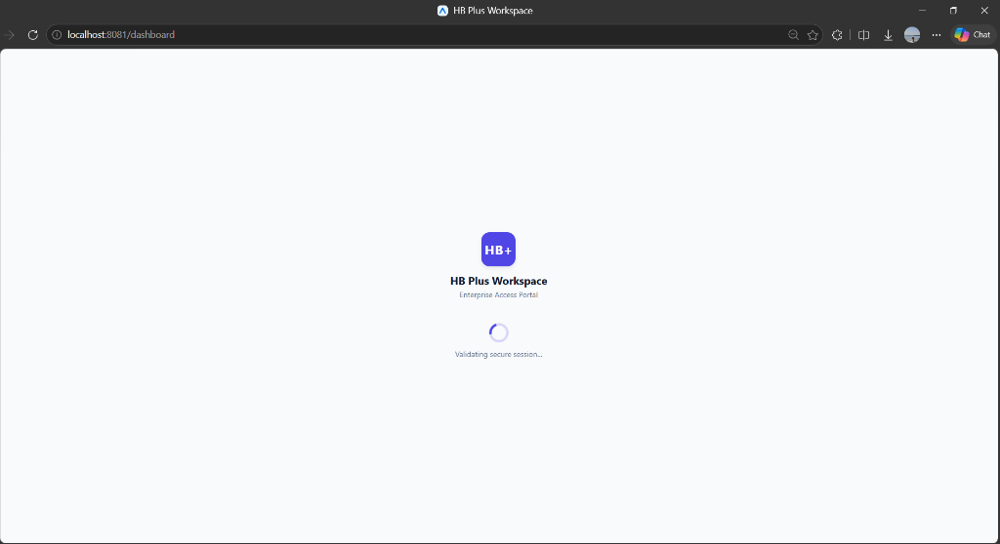
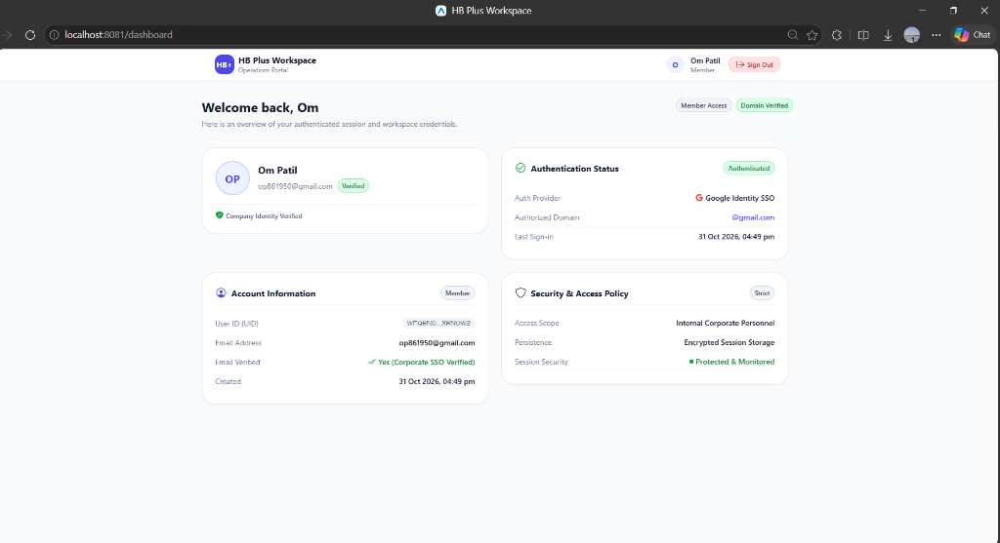
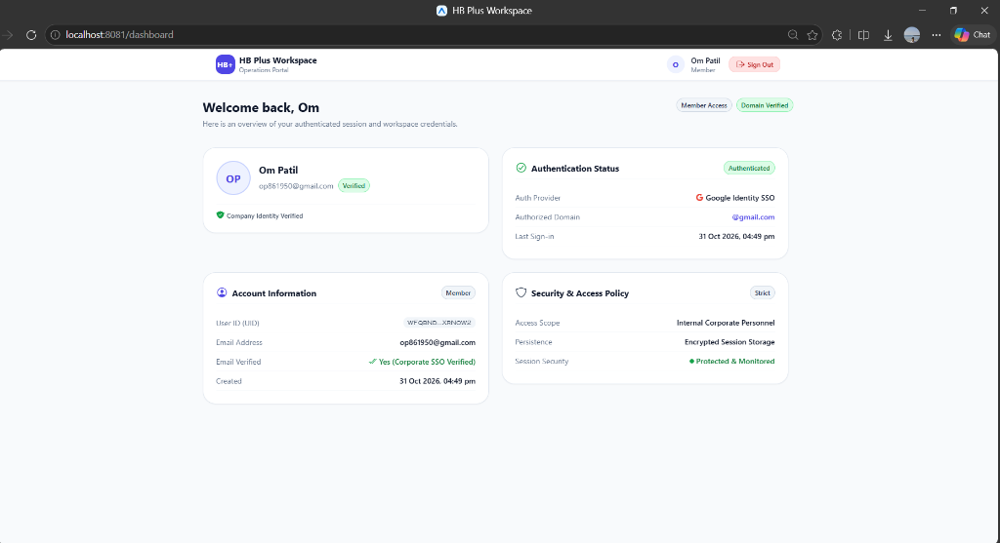
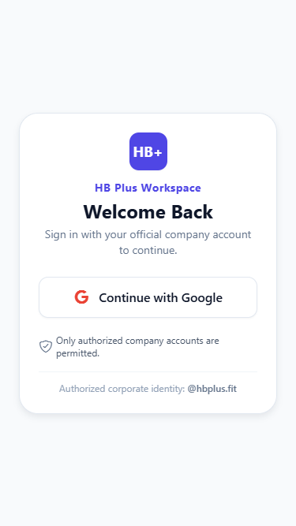
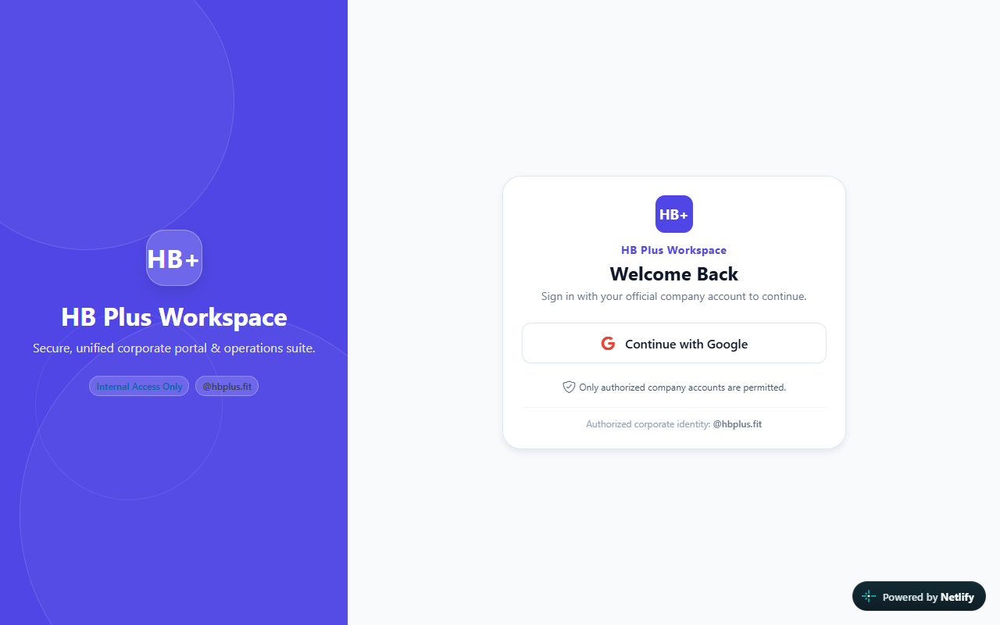

# HB Plus Workspace

[](https://harmonious-squirrel-5cbd03.netlify.app)
[](https://github.com/Aditya-Patil-63/hbplus-workspace)
[](https://www.typescriptlang.org/)
[](https://expo.dev/)
[](https://firebase.google.com/)

> Enterprise Workspace & Single Sign-On (SSO) Portal built with **Expo**, **React Native for Web**, and **Firebase Authentication**, strictly restricted to authorized company domain accounts (`@hbplus.fit`).

**Live Demo Deployment**: [https://harmonious-squirrel-5cbd03.netlify.app](https://harmonious-squirrel-5cbd03.netlify.app)  
**GitHub Repository**: [https://github.com/Aditya-Patil-63/hbplus-workspace](https://github.com/Aditya-Patil-63/hbplus-workspace)

---

## 1. Overview & Problem Statement

### The Problem
Organizations utilizing enterprise productivity tools often face security and operational risks when employees or contractors access corporate assets using personal Gmail or external accounts. Standard OAuth workflows frequently permit any authenticated Google account unless rigorous domain validation is enforced across client sessions, mobile platforms, and backend rules.

### The Solution
**HB Plus Workspace** delivers a secure, responsive, cross-platform portal designed for company personnel. It implements:
* Zero-trust corporate domain restriction (`@hbplus.fit`) with defense against subdomain spoofing, evil suffixes, and prefix attacks.
* Immediate session termination and sign-out upon detection of unauthorized identities.
* Seamless web and native mobile support using modern Expo Router file-based navigation.
* Client-side route protection coupled with Cloud Firestore security rules.

---

## 2. Key Features

* **Strict Domain Whitelisting**: Exclusively accepts authenticated accounts matching `@hbplus.fit` with verified email addresses (`user.emailVerified === true`).
* **Cross-Platform Google SSO**:
  * **Web**: Native Firebase Web SDK with Google Popup sign-in and automated fallback to Redirect sign-in when browser popups are blocked.
  * **Native (iOS/Android)**: `@react-native-google-signin/google-signin` native credential exchange with zero token persistence in application storage.
  * **Web Bundle Isolation**: Platform file separation (`authService.web.ts` and `authService.native.ts`) prevents native Google modules from ever entering the web bundle.
* **Declarative Protected Routing**: Custom `<ProtectedRoute />` wrapper that blocks premature component mounting and ensures unauthenticated traffic redirects to `/login`.
* **Session Refresh Protection**: Re-validates domain membership on every page refresh or mobile session restoration before granting access.
* **Premium SaaS Design System**: Consistent design tokens in `constants/theme.ts` (deep indigo `#4F46E5`, slate neutrals, soft background `#F8FAFC`, responsive typography scale, cross-platform shadow presets).
* **Responsive Architecture**:
  * Desktop (`>= 900px`): Split-screen login featuring an indigo brand panel and centered 440px card; 2-column dashboard grid.
  * Mobile (`< 900px`): Single-column view with touch-friendly controls (min 52px buttons) and responsive navigation.
* **Role-Based Access Control (RBAC)**: Secure read-only role retrieval from Firestore (`users/{uid}`), exposing an administrative tools suite to users with `role: "admin"`.
* **Production Deployment Ready**: Preconfigured with `netlify.toml` for Single Page Application (SPA) hosting with `npx expo export --platform web`.

---

## 3. Technology Stack

| Layer | Technologies |
|:---|:---|
| **Framework** | [Expo SDK 58](https://expo.dev) with [Expo Router](https://docs.expo.dev/router/introduction/) |
| **Core UI** | [React 19](https://react.dev), [React Native 0.88](https://reactnative.dev), [React Native Web](https://necolas.github.io/react-native-web/) |
| **Authentication** | [Firebase Authentication v13 (Modular)](https://firebase.google.com/docs/auth) |
| **Native Google Auth** | [@react-native-google-signin/google-signin](https://github.com/react-native-google-signin/google-signin) |
| **Database & Rules** | [Cloud Firestore](https://firebase.google.com/docs/firestore) |
| **Icons & Assets** | [@expo/vector-icons (Ionicons)](https://icons.expo.fyi) |
| **Hosting & CI/CD** | [Netlify](https://www.netlify.com) |
| **Language & Tooling** | TypeScript 5.8+, tsx, Node.js v24+ |

---

## 4. Project Directory Structure

```text
├── app/
│   ├── _layout.tsx                 # Root layout: SafeAreaProvider & AuthProvider
│   ├── index.tsx                   # Entry redirect: routes to /dashboard or /login
│   ├── login.tsx                   # Responsive split-screen login page
│   └── dashboard.tsx               # Protected dashboard with profile & account cards
├── components/
│   ├── Badge.tsx                   # Multi-variant status pill (success/info/neutral/danger)
│   ├── GoogleLoginButton.tsx       # Touch-friendly SSO button with pressed/hover states
│   ├── LoadingScreen.tsx           # Brand monogram splash with ActivityIndicator
│   ├── ProfileCard.tsx             # User card with photo & fallback initials avatar
│   └── ProtectedRoute.tsx          # Zero-leakage route protection gate
├── config/
│   └── firebase.ts                 # Firebase modular app & platform persistence setup
├── constants/
│   └── theme.ts                    # SaaS design palette, spacing, radii, typography, shadows
├── contexts/
│   └── AuthContext.tsx             # Global auth context, role fetching, session lifecycle
├── docs/
│   ├── AUTHENTICATION_FLOW.md      # Detailed authentication architectural specifications
│   ├── FIREBASE_SETUP.md           # Step-by-step console setup guide
│   └── TESTING_CHECKLIST.md        # QA verification matrix with 15 scenarios
├── services/
│   ├── authService.ts              # Unified platform dispatch entry point
│   ├── authService.web.ts          # Web popup/redirect authentication implementation
│   ├── authService.native.ts       # Native Google Sign-In & credential exchange
│   └── authTypes.ts                # Auth error constants, cancel checks, error mapper
├── utils/
│   ├── domainValidation.ts         # Strict email domain verification function
│   └── domainValidation.test.ts    # Unit test suite covering domain attacks
├── .env.example                    # Template for required environment variables
├── .gitignore                      # Git exclusion rules for node_modules, keys, .env
├── app.json                        # Expo configuration and native bundle identifiers
├── firestore.rules                 # Cloud Firestore security rules
├── netlify.toml                    # Netlify SPA build and redirect rules
├── package.json                    # Dependencies, scripts, and Expo Router entry
├── README.md                       # Project master documentation
└── tsconfig.json                   # Strict TypeScript compiler options
```

---

## 5. Installation & Local Setup

### Prerequisites
* Node.js LTS (v20+ or v24+)
* npm (v10+)
* Git

### Step-by-Step Installation
1. Clone the repository and navigate into the project directory:
   ```bash
   git clone <repository-url>
   cd Assignment
   ```
2. Install project dependencies:
   ```bash
   npm install
   ```
3. Copy environment configuration:
   ```bash
   cp .env.example .env
   ```

---

## 6. Environment Configuration

Populate your `.env` file with credentials from your Firebase and Google Cloud consoles:

```env
# Firebase Project Settings
EXPO_PUBLIC_FIREBASE_API_KEY=AIzaSy...
EXPO_PUBLIC_FIREBASE_AUTH_DOMAIN=your-project.firebaseapp.com
EXPO_PUBLIC_FIREBASE_PROJECT_ID=your-project-id
EXPO_PUBLIC_FIREBASE_STORAGE_BUCKET=your-project.appspot.com
EXPO_PUBLIC_FIREBASE_MESSAGING_SENDER_ID=123456789012
EXPO_PUBLIC_FIREBASE_APP_ID=1:123456789012:web:abcdef...

# Google OAuth Client IDs
EXPO_PUBLIC_GOOGLE_WEB_CLIENT_ID=123456789012-xxx.apps.googleusercontent.com
EXPO_PUBLIC_GOOGLE_IOS_CLIENT_ID=123456789012-yyy.apps.googleusercontent.com

# Authorized Corporate Domain
EXPO_PUBLIC_ALLOWED_DOMAIN=hbplus.fit
```

---

## 7. Firebase & Google OAuth Configuration

Follow the detailed walkthrough in [`docs/FIREBASE_SETUP.md`](docs/FIREBASE_SETUP.md):
1. **Authentication Provider**: Enable **Google** in Firebase Authentication Console.
2. **Authorized Domains**: Add `localhost` and your Netlify domain (`harmonious-squirrel-5cbd03.netlify.app`).
3. **Firestore Security Rules**: Deploy the rules from [`firestore.rules`](firestore.rules).
4. **User Roles**: Roles cannot be modified by the client. To grant admin privileges, create a document in collection `users` with ID = `{user.uid}` and field `role: "admin"`.

---

## 8. Domain Validation Algorithm

Implemented in [`utils/domainValidation.ts`](utils/domainValidation.ts):

* **Exact '@' Boundary Check**: Ensures exactly one `@` symbol is present.
* **Lowercase Normalization**: Trims whitespace and normalizes both email and allowed domain to lowercase.
* **Strict Equality**: Compares `domainPart === ALLOWED_DOMAIN`. Never uses naive regex or `endsWith()`.
* **Rejects Threat Vectors**:
  * `user@hbplus.fit.evil.com` -> Rejected (evil suffix attack)
  * `user@evilhbplus.fit` -> Rejected (prefix attack)
  * `user@sub.hbplus.fit` -> Rejected (unauthorized subdomain)
  * `a@b@hbplus.fit` -> Rejected (multi-@ attack)
  * `user@gmail.com` -> Rejected (unauthorized domain)

Run the unit tests:
```bash
npm run test:domain
```

---

## 9. Running the Application

### A. Web (Desktop & Mobile Browser)
Start the local Metro development server for web:
```bash
npm run web
```
Open your browser at `http://localhost:8081`.

Build and bundle for static web export:
```bash
npm run build:web
```
Outputs static assets into `dist/`.

### B. Native Android & iOS (Development Build Required)
> [!IMPORTANT]
> **Expo Go is not supported for native builds.**
> Because this application utilizes `@react-native-google-signin/google-signin` (which includes custom native code), it **must be run in a development build** or standalone native build.

1. Generate native iOS and Android projects:
   ```bash
   npx expo prebuild
   ```
2. Place credentials in project root:
   * Android: `google-services.json`
   * iOS: `GoogleService-Info.plist`
3. Update `app.json` with credential file paths:
   ```json
   "ios": { "googleServicesFile": "./GoogleService-Info.plist" },
   "android": { "googleServicesFile": "./google-services.json" }
   ```
4. Run locally on Android device / emulator:
   ```bash
   npx expo run:android
   ```
5. Run locally on iOS simulator (macOS required):
   ```bash
   npx expo run:ios
   ```

---

## 10. Netlify Deployment

This project is fully configured for deployment on [Netlify](https://www.netlify.com).

### Configuration (`netlify.toml`)
```toml
[build]
  command = "npx expo export --platform web"
  publish = "dist"

[[redirects]]
  from = "/*"
  to = "/index.html"
  status = 200
```

### Deployment Steps:
1. Connect your repository to Netlify.
2. In the Netlify dashboard under **Site Settings > Environment Variables**, add every variable from `.env.example`:
   * `EXPO_PUBLIC_FIREBASE_API_KEY`
   * `EXPO_PUBLIC_FIREBASE_AUTH_DOMAIN`
   * `EXPO_PUBLIC_FIREBASE_PROJECT_ID`
   * `EXPO_PUBLIC_FIREBASE_STORAGE_BUCKET`
   * `EXPO_PUBLIC_FIREBASE_MESSAGING_SENDER_ID`
   * `EXPO_PUBLIC_FIREBASE_APP_ID`
   * `EXPO_PUBLIC_GOOGLE_WEB_CLIENT_ID`
   * `EXPO_PUBLIC_GOOGLE_IOS_CLIENT_ID`
   * `EXPO_PUBLIC_ALLOWED_DOMAIN`
3. In Firebase Console under **Authentication > Settings > Authorized domains**, add `harmonious-squirrel-5cbd03.netlify.app`.
4. Trigger a deploy or run `npx netlify-cli deploy --dir=dist --prod`. Netlify runs `npx expo export --platform web` and publishes `dist`.

**Live Production Site**: [https://harmonious-squirrel-5cbd03.netlify.app](https://harmonious-squirrel-5cbd03.netlify.app)  
**Status**: Deployed and operational (SPA routing active, root redirects to `/login`, `/dashboard` protected).

---

## 11. Screenshots & Previews

### Visual Evidence & UI Gallery

| Scenario / Screen | Preview | Description |
| :--- | :--- | :--- |
| **Desktop Split-Screen Login** |  | Indigo branding hero banner, centered login card, `@hbplus.fit` corporate badge |
| **Access Restricted (Non-Domain Rejection)** |  | Error banner: *"Access restricted. Please login using your official domain email."* |
| **Session Validation Loading** |  | Splash screen with animated spinner while session and domain membership are validated |
| **Authenticated Workspace Dashboard** |  | Responsive corporate dashboard with profile card, verification badge, and security policies |
| **Session Restoration on Refresh** |  | Verified persistent authentication without re-login after browser refresh |
| **Mobile Responsive Login** |  | Single-column mobile layout with 52px touch-friendly Google SSO button |
| **Live Netlify Production Deployment** |  | Operational SPA deployment on `harmonious-squirrel-5cbd03.netlify.app` |

---

### Detailed Scenario Walkthroughs

#### 1. Unauthorized Domain Rejection (Security Gate)
When an external Google account (e.g. `@gmail.com` or spoofed domains) attempts to authenticate, the security gate immediately invokes `signOut(auth)`, purges transient credentials, and displays the required specification error banner:

> *"Access restricted. Please login using your official domain email."*


#### 2. Authenticated Workspace Dashboard
Upon logging in with an authorized identity, the user is admitted to the secure portal displaying user avatar fallback initials, verification badges, Firebase UID, authorized domain status, and enterprise security policies:


#### 3. Session Validation & Hydration Splash
During application initialization or route hydration, the `<LoadingScreen />` guards against premature component mounting and prevents any flash of protected dashboard content:


#### 4. Seamless Session Restoration on Page Reload
On browser refresh (F5), Firebase session storage is re-evaluated and re-validated against domain rules, restoring the active dashboard without requiring the user to re-authenticate:


#### 5. Cross-Platform Responsive Breakpoints
The UI dynamically adapts across desktop and mobile form factors:

| Desktop Split-Screen (`>= 900px`) | Mobile Viewport (`< 600px`) |
| :---: | :---: |
|  |  |

#### 6. Live Production Netlify Deployment
The production deployment on Netlify renders SPA routes with 200 rewrites, redirects root `/` to `/login`, and safeguards direct unauthorized access to `/dashboard`:


### Desktop Split-Screen Login (`>= 900px`)
```text
+-------------------------------------------------------------------------+
| [ Indigo Brand Panel ]                   | [ Centered Sign-In Card ]    |
|                                          |                              |
|   (HB+) Monogram Mark                    |   (HB+) Monogram             |
|   HB Plus Workspace                      |   HB Plus Workspace          |
|   Enterprise Operations Portal           |   Welcome Back               |
|                                          |                              |
|   [ Internal Access Only ]               |   [G Continue with Google]   |
|   [ @hbplus.fit ]                        |   (Shield) Company only      |
|                                          |                              |
+-------------------------------------------------------------------------+
```

### Mobile Single-Column Login (`< 900px`)
```text
+-----------------------------+
|   (HB+) Monogram            |
|   HB Plus Workspace         |
|   Welcome Back              |
|                             |
|   [G Continue with Google]  |
|   (Shield) Authorized only  |
+-----------------------------+
```

### Authenticated Workspace Dashboard
```text
+-------------------------------------------------------------------------+
| (HB+) HB Plus Workspace                               (Avatar) Sign Out |
+-------------------------------------------------------------------------+
| Welcome back, John                       [ Member Access ] [ Verified ] |
|                                                                         |
| +-----------------------------+  +------------------------------------+ |
| | Profile Card                |  | Authentication Status              | |
| | (Avatar) John Doe           |  | Provider: Google Identity SSO      | |
| | john.doe@hbplus.fit [✓]     |  | Domain: @hbplus.fit                | |
| +-----------------------------+  +------------------------------------+ |
| +-----------------------------+  +------------------------------------+ |
| | Account Information         |  | Security & Access Policy           | |
| | UID: Ab12...9Z              |  | Strict Domain Whitelist            | |
| | Verified: Yes               |  | Protected & Monitored              | |
| +-----------------------------+  +------------------------------------+ |
+-------------------------------------------------------------------------+
```

---

## 12. Security Considerations

### Limitations of Client-Side Validation
While the application performs rigorous validation in `services/authService.ts` and `contexts/AuthContext.tsx` by rejecting non-`@hbplus.fit` emails and immediately invoking `signOut(auth)`, **client-side code runs in an untrusted environment**. A malicious user could theoretically manipulate client JavaScript in developer tools to bypass client redirects.

### Robust Server-Side Security Enforcement:
To maintain end-to-end security, enterprise applications should pair client validation with server-side boundaries:

1. **Firestore Security Rules (Implemented)**:
   All database access is constrained by `firestore.rules`, checking `request.auth.token.email.matches('.*@hbplus\\.fit')` and `email_verified == true`. Unauthorized users cannot read or write any corporate data, even if they bypass the client UI.
2. **Firebase Auth Blocking Functions (Recommended)**:
   Using Google Cloud Identity Platform, configure a `beforeSignIn` Cloud Function:
   ```javascript
   exports.beforeSignIn = functions.auth.user().beforeSignIn((user, context) => {
     if (!user.email || !user.email.endsWith('@hbplus.fit') || !user.emailVerified) {
       throw new functions.auth.HttpsError('permission-denied', 'Only verified @hbplus.fit accounts may authenticate.');
     }
   });
   ```
   This prevents unauthorized user accounts from ever being created or issued Firebase Auth tokens in the first place.
3. **Backend API Token Verification**:
   When communicating with backend microservices, transmit the Firebase ID token in the `Authorization: Bearer <token>` header and verify it using the Firebase Admin SDK (`admin.auth().verifyIdToken(token)`), inspecting `decodedToken.email`.

---

## 13. Quality Verification & Audit

| Check | Command / Scenario | Result | Notes |
|:---|:---|:---:|:---|
| **Domain Validation Tests** | `npm run test:domain` | **14 / 14 Passed** | Pure unit test suite passing in strict mode. |
| **TypeScript Typecheck** | `npm run typecheck` | **0 Errors** | Clean compilation. |
| **Web Production Export** | `npx expo export --platform web` | **Clean Export** | Bundled 909 modules into `dist/`. |
| **Expo Project Doctor** | `npx expo-doctor` | **Passed** | Clean dependency tree and configuration. |
| **Gmail Rejection Flow** | Manual Browser Test | **VERIFIED** | Non-allowed email immediately rejected with exact spec message. |
| **Dashboard Allow-Path Flow** | Manual Browser Test | **VERIFIED** | Verified by temporarily setting `EXPO_PUBLIC_ALLOWED_DOMAIN=gmail.com` for verification, then reverted to `hbplus.fit` for production. |
| **Session Restoration** | Manual Browser Test | **VERIFIED** | Re-validated session across page refresh without data loss. |
| **Logout & History Back** | Manual Browser Test | **VERIFIED** | `router.replace('/login')` ensures history back does not re-open dashboard. |
| **Native iOS/Android OAuth** | Native Build | **IMPLEMENTED, NOT TESTED** | Requires development build (`npx expo run:android\|ios`) and client credentials. |
| **Admin Tools (Bonus)** | Role Evaluation | **IMPLEMENTED, NOT TESTED** | Requires setting `role: "admin"` in Firestore `users/{uid}` via Firebase Console. |

---

## 14. Future Improvements

* **Multi-Factor Authentication (MFA)**: Enforce SMS or TOTP authenticator app challenges via Firebase Identity Platform for admin roles.
* **Custom Enterprise Claims**: Migrate role assignment from Firestore documents directly into Firebase Auth custom user claims (`customClaims.admin === true`).
* **Audit Logging Pipeline**: Automatically stream login timestamps, user agents, and IP addresses into a BigQuery or Cloud Logging dataset.
* **Offline Synchronization**: Implement offline cache persistence with Firestore offline capabilities for field mobile operations.
